<h1 align="center">Object Oriented Programming using Python</h1>


## Student Information

| **Field** | **Details** |
|:---|:---|
| **Name** | Janvi |
| **Roll Number** | 26570025 |
| **Programme** | B.Sc. (Hons.) Computer Science |
| **Semester** | I |
| **College** | Ramanujan College |
| **University** | University of Delhi |
| **Tool / Language** | Python 3 |

---


## How to run

1. Install Python 3, then extract this ZIP before running programs.
2. Open a terminal in the `Programs` folder.
3. Run a practical, for example:

   ```bash
   python practical_01_quadratic.py
   ```

   On Windows, `py` can be used instead of `python`; on macOS/Linux, use `python3` if needed.
4. Enter the sample values shown below each practical. All programs use only the Python standard library.

Keep practicals 13 and 14 in the same folder because practical 14 imports practical 13. Practical 9 writes `File1` and `File2` in the working folder. Practical 12 intentionally exits with status 1 after demonstrating a negative salary component. Outputs are actual captured runs, with entered values echoed; PNGs present those transcripts for viewing. Text transcripts are also included in `Outputs`.

---

## Contents

| No. | Practical | Program file |
| :--- | :--- | :--- |
| 1 | [Roots of a Quadratic Equation](#practical-1-roots-of-a-quadratic-equation) | [`practical_01_quadratic.py`](Programs/practical_01_quadratic.py) |
| 2 | [Prime Numbers](#practical-2-prime-numbers) | [`practical_02_prime_numbers.py`](Programs/practical_02_prime_numbers.py) |
| 3 | [Pyramid and Reverse Pyramid](#practical-3-pyramid-and-reverse-pyramid) | [`practical_03_pyramids.py`](Programs/practical_03_pyramids.py) |
| 4 | [Character Check](#practical-4-character-check) | [`practical_04_character_check.py`](Programs/practical_04_character_check.py) |
| 5 | [Operations on a String](#practical-5-operations-on-a-string) | [`practical_05_string_operations.py`](Programs/practical_05_string_operations.py) |
| 6 | [Swap the First n Characters of Two Strings](#practical-6-swap-the-first-n-characters-of-two-strings) | [`practical_06_swap_characters.py`](Programs/practical_06_swap_characters.py) |
| 7 | [Indices of a Substring](#practical-7-indices-of-a-substring) | [`practical_07_find_substring_indices.py`](Programs/practical_07_find_substring_indices.py) |
| 8 | [Cubes of Even Integers](#practical-8-cubes-of-even-integers) | [`practical_08_cubes_of_even.py`](Programs/practical_08_cubes_of_even.py) |
| 9 | [File Handling](#practical-9-file-handling) | [`practical_09_file_handling.py`](Programs/practical_09_file_handling.py) |
| 10 | [Dictionary of Cubes](#practical-10-dictionary-of-cubes) | [`practical_10_dictionary_cubes.py`](Programs/practical_10_dictionary_cubes.py) |
| 11 | [Tuple Operations](#practical-11-tuple-operations) | [`practical_11_tuples.py`](Programs/practical_11_tuples.py) |
| 12 | [Employee Class](#practical-12-employee-class) | [`practical_12_employee_class.py`](Programs/practical_12_employee_class.py) |
| 13 | [Class 2DPoint](#practical-13-class-2dpoint) | [`practical_13_point2d.py`](Programs/practical_13_point2d.py) |
| 14 | [Class 3DPoint (Inheritance)](#practical-14-class-3dpoint-inheritance) | [`practical_14_point3d.py`](Programs/practical_14_point3d.py) |
| 15 | [Exception Handling](#practical-15-exception-handling) | [`practical_15_exception_handling.py`](Programs/practical_15_exception_handling.py) |


---

# Practical 1: Roots of a Quadratic Equation

**Question:** Write a program to find the roots of a quadratic equation.

**Concepts used:** `cmath`, discriminant, `if / elif / else`, complex roots

**Program** (`practical_01_quadratic.py`)

```python
# Name: Janvi
# Roll Number: 26570025

# Practical 1: WAP to find the roots of a quadratic equation  (ax^2 + bx + c = 0)
import cmath


def quadratic_roots(a, b, c):
    """Return the two roots of ax^2 + bx + c = 0 (real or complex)."""
    d = b ** 2 - 4 * a * c            # discriminant
    root1 = (-b + cmath.sqrt(d)) / (2 * a)
    root2 = (-b - cmath.sqrt(d)) / (2 * a)
    return d, root1, root2


print("Quadratic equation: ax^2 + bx + c = 0")
a = float(input("Enter a: "))
b = float(input("Enter b: "))
c = float(input("Enter c: "))

if a == 0:
    print("'a' cannot be 0 - this is not a quadratic equation.")
    if b != 0:
        print("It is linear, with root x =", -c / b)
else:
    d, r1, r2 = quadratic_roots(a, b, c)
    print("Discriminant =", d)
    if d > 0:
        print("Roots are real and distinct.")
        print("x1 =", r1.real, "\nx2 =", r2.real)
    elif d == 0:
        print("Roots are real and equal.")
        print("x1 = x2 =", r1.real)
    else:
        print("Roots are complex conjugates.")
        print("x1 =", r1, "\nx2 =", r2)
```

**Sample input to try:** `a = 1`, `b = -3`, `c = 2` 

**Output**


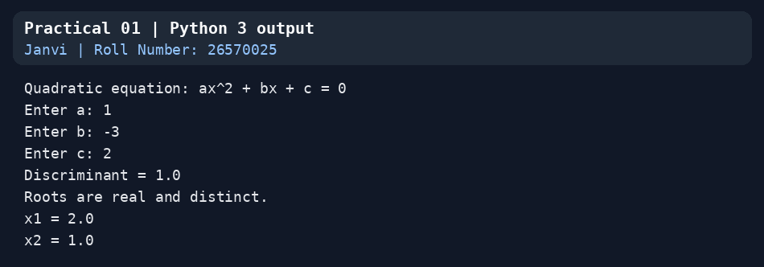


---

# Practical 2: Prime Numbers

**Question:** Write a program to accept a number 'n' and

- a. Check if 'n' is prime
- b. Generate all prime numbers till 'n'
- c. Generate first 'n' prime numbers

This program may be done using functions.

**Concepts used:** functions, `while` loop, list comprehension

**Program** (`practical_02_prime_numbers.py`)

```python
# Name: Janvi
# Roll Number: 26570025

# Practical 2: WAP to accept a number 'n' and
#   a. Check if 'n' is prime
#   b. Generate all prime numbers till 'n'
#   c. Generate first 'n' prime numbers
# (done using functions)


def is_prime(num):
    """Return True if num is a prime number."""
    if num < 2:
        return False
    i = 2
    while i * i <= num:
        if num % i == 0:
            return False
        i += 1
    return True


def primes_till(n):
    """Return a list of all primes <= n."""
    return [i for i in range(2, n + 1) if is_prime(i)]


def first_n_primes(n):
    """Return a list of the first n primes."""
    result = []
    candidate = 2
    while len(result) < n:
        if is_prime(candidate):
            result.append(candidate)
        candidate += 1
    return result


n = int(input("Enter a number n: "))

# a
if is_prime(n):
    print(f"a) {n} is a prime number")
else:
    print(f"a) {n} is not a prime number")

# b
print(f"b) Prime numbers till {n}:", primes_till(n))

# c
print(f"c) First {n} prime numbers:", first_n_primes(n))
```

**Sample input to try:** `n = 10`

**Output**

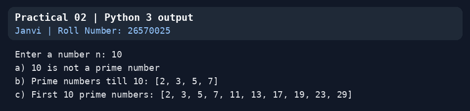


---

# Practical 3: Pyramid and Reverse Pyramid

**Question:** Write a program to create a pyramid of the character '\*' and a reverse pyramid.

**Concepts used:** nested logic with string repetition (`" " * k + "*" * m`)

**Program** (`practical_03_pyramids.py`)

```python
# Name: Janvi
# Roll Number: 26570025

# Practical 3: WAP to create a pyramid of the character '*' and a reverse pyramid


def pyramid(rows):
    """Print a pyramid with the given number of rows (1, 3, 5, ... stars)."""
    for i in range(1, rows + 1):
        print(" " * (rows - i) + "*" * (2 * i - 1))


def reverse_pyramid(rows):
    """Print a reverse (inverted) pyramid with the given number of rows."""
    for i in range(rows, 0, -1):
        print(" " * (rows - i) + "*" * (2 * i - 1))


rows = int(input("Enter the number of rows: "))

print("\nPyramid:\n")
pyramid(rows)

print("\nReverse pyramid:\n")
reverse_pyramid(rows)
```

**Sample input to try:** `5` rows

**Output**

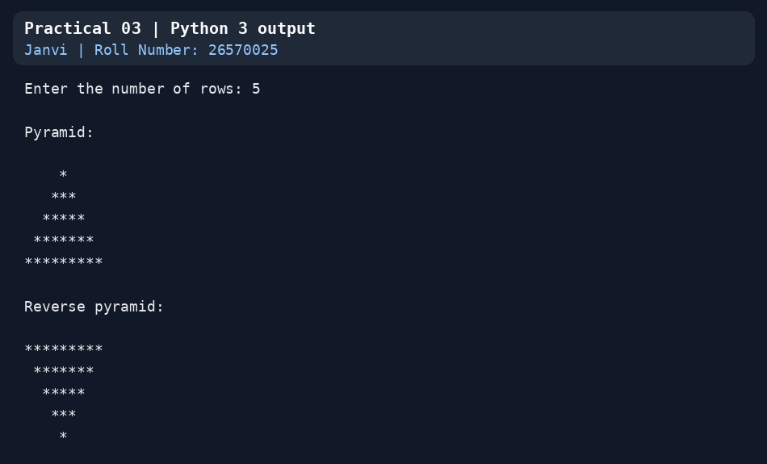


---

# Practical 4: Character Check

**Question:** Write a program that accepts a character and performs the following:

- a. print whether the character is a letter or numeric digit or a special character.
- b. if the character is a letter, print whether the letter is uppercase or lowercase
- c. if the character is a numeric digit, prints its name in text (e.g., if input is 9, output is NINE)

**Concepts used:** `isalpha()`, `isupper()`, `isdigit()`, dictionary lookup

**Program** (`practical_04_character_check.py`)

```python
# Name: Janvi
# Roll Number: 26570025

# Practical 4: WAP that accepts a character and performs the following:
#   a. print whether the character is a letter or numeric digit or a special character
#   b. if the character is a letter, print whether the letter is uppercase or lowercase
#   c. if the character is a numeric digit, print its name in text (e.g. 9 -> NINE)

DIGIT_NAMES = {
    '0': "ZERO", '1': "ONE", '2': "TWO", '3': "THREE", '4': "FOUR",
    '5': "FIVE", '6': "SIX", '7': "SEVEN", '8': "EIGHT", '9': "NINE",
}

ch = input("Enter a single character: ")

if len(ch) != 1:
    print("Please enter exactly one character.")
elif ch.isalpha():
    print(f"'{ch}' is a letter")
    if ch.isupper():
        print("It is an uppercase letter")
    else:
        print("It is a lowercase letter")
elif ch.isdigit():
    print(f"'{ch}' is a numeric digit")
    print("Name in text:", DIGIT_NAMES.get(ch, "(not a decimal digit 0-9)"))
else:
    print(f"'{ch}' is a special character")
```

**Sample input to try:** `9`, then `a`, `G` and `@`

**Output**

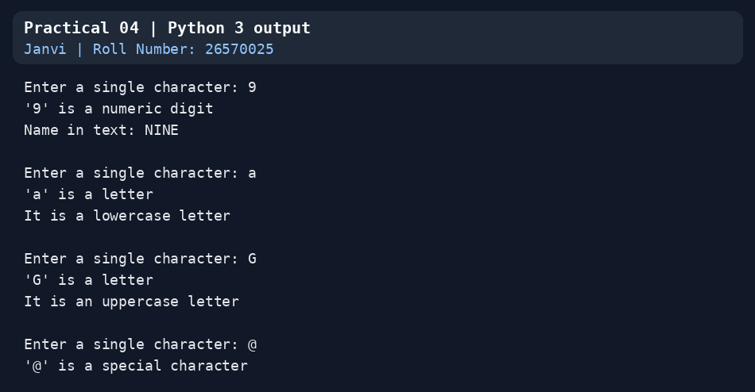


---

# Practical 5: Operations on a String

**Question:** Write a program to perform the following operations on a string

- a. Find the frequency of a character in a string.
- b. Replace a character by another character in a string.
- c. Remove the first occurrence of a character from a string.
- d. Remove all occurrences of a character from a string.

**Concepts used:** string traversal, `find()`, slicing, functions

**Program** (`practical_05_string_operations.py`)

```python
# Name: Janvi
# Roll Number: 26570025

# Practical 5: WAP to perform the following operations on a string
#   a. Find the frequency of a character in a string
#   b. Replace a character by another character in a string
#   c. Remove the first occurrence of a character from a string
#   d. Remove all occurrences of a character from a string


def frequency(s, ch):
    count = 0
    for c in s:
        if c == ch:
            count += 1
    return count


def replace_char(s, old, new):
    result = ""
    for c in s:
        result += new if c == old else c
    return result


def remove_first(s, ch):
    index = s.find(ch)
    if index == -1:
        return s
    return s[:index] + s[index + 1:]


def remove_all(s, ch):
    result = ""
    for c in s:
        if c != ch:
            result += c
    return result


text = input("Enter a string: ")

ch = input("a) Enter a character to find its frequency: ")[:1]
print(f"   '{ch}' occurs {frequency(text, ch)} time(s)")

old = input("b) Enter the character to be replaced: ")[:1]
new = input("   Enter the new character: ")[:1]
print("   Result:", replace_char(text, old, new))

ch = input("c) Enter a character to remove its first occurrence: ")[:1]
print("   Result:", remove_first(text, ch))

ch = input("d) Enter a character to remove all its occurrences: ")[:1]
print("   Result:", remove_all(text, ch))
```

**Sample input to try:** `banana`, then `a`, `a`→`z`, `n`, `b`

**Output**

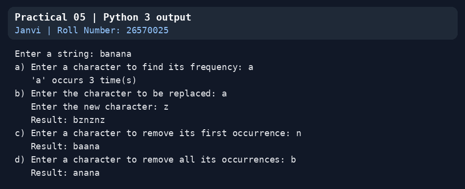


---

# Practical 6: Swap the First n Characters of Two Strings

**Question:** Write a program to swap the first n characters of two strings.

**Concepts used:** string slicing and concatenation

**Program** (`practical_06_swap_characters.py`)

```python
# Name: Janvi
# Roll Number: 26570025

# Practical 6: WAP to swap the first n characters of two strings


def swap_first_n(s1, s2, n):
    """Return (s1', s2') after exchanging the first n characters."""
    return s2[:n] + s1[n:], s1[:n] + s2[n:]


str1 = input("Enter the first string: ")
str2 = input("Enter the second string: ")
n = int(input("Enter n (number of characters to swap): "))

if n < 0 or n > len(str1) or n > len(str2):
    print("n must be between 0 and the length of the shorter string.")
else:
    new1, new2 = swap_first_n(str1, str2, n)
    print("Before swapping:", str1, "|", str2)
    print("After swapping :", new1, "|", new2)
```

**Sample input to try:** `hello`, `world`, `n = 2`

**Output**

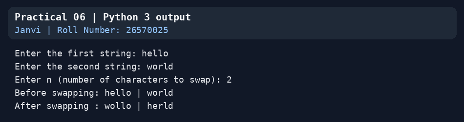

---

# Practical 7: Indices of a Substring

**Question:** Write a function that accepts two strings and returns the indices of all the occurrences of the second string in the first string as a list. If the second string is not present in the first string then it should return -1.

**Concepts used:** `str.find(sub, start)`, lists, return values

**Program** (`practical_07_find_substring_indices.py`)

```python
# Name: Janvi
# Roll Number: 26570025

# Practical 7: Write a function that accepts two strings and returns the indices of
# all the occurrences of the second string in the first string as a list.
# If the second string is not present in the first string then it should return -1.


def find_all(first, second):
    indices = []
    start = first.find(second)
    while start != -1:
        indices.append(start)
        start = first.find(second, start + 1)   # +1 also finds overlapping matches
    return indices if indices else -1


s1 = input("Enter the first string: ")
s2 = input("Enter the second string: ")

if s2 == "":
    print("The second string must not be empty.")
else:
    print("Result:", find_all(s1, s2))
```

**Sample input to try:** `abababa`, `aba` (overlapping matches), then `abc`, `z` (returns -1)

**Output**

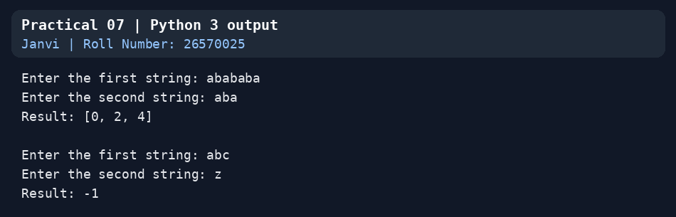


---

# Practical 8: Cubes of Even Integers

**Question:** Write a program to create a list of the cubes of only the even integers appearing in the input list (may have elements of other types also) using the following:

- a. 'for' loop
- b. list comprehension

**Concepts used:** `isinstance()`, `for` loop, list comprehension (`bool` is excluded on purpose, because `True` is an `int` in Python)

**Program** (`practical_08_cubes_of_even.py`)

```python
# Name: Janvi
# Roll Number: 26570025

# Practical 8: WAP to create a list of the cubes of only the even integers appearing
# in the input list (may have elements of other types also) using:
#   a. 'for' loop
#   b. list comprehension

# The input list is mixed on purpose: ints, floats, strings, bool and None.
data = [1, 2, 3, 4, "hello", 6, 7.0, 8, 9, 10, True, None, "12", 14, -2]
print("Input list:", data)


def is_integer(x):
    # bool is a subclass of int in Python, so it is excluded explicitly
    return isinstance(x, int) and not isinstance(x, bool)


# a. using a for loop
cubes_loop = []
for item in data:
    if is_integer(item) and item % 2 == 0:
        cubes_loop.append(item ** 3)
print("a) Using for loop          :", cubes_loop)

# b. using list comprehension
cubes_comp = [x ** 3 for x in data if is_integer(x) and x % 2 == 0]
print("b) Using list comprehension:", cubes_comp)
```

**Sample input to try:** no input: the mixed list is inside the program

**Output**

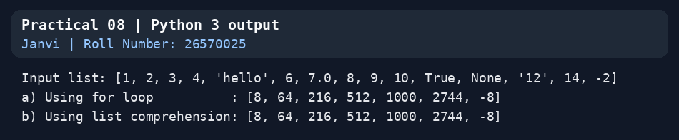


---

# Practical 9: File Handling

**Question:** Write a program to read a file and

- a. Print the total number of characters, words and lines in the file.
- b. Calculate the frequency of each character in the file. Use a variable of dictionary type to maintain the count.
- c. Print the words in reverse order.
- d. Copy even lines of the file to a file named 'File1' and odd lines to another file named 'File2'.

**Concepts used:** `open()` with `with`, `readlines()`, dictionary counting, `split()`, `enumerate()`

**Program** (`practical_09_file_handling.py`)

```python
# Name: Janvi
# Roll Number: 26570025

# Practical 9: WAP to read a file and
#   a. Print the total number of characters, words and lines in the file.
#   b. Calculate the frequency of each character in the file. Use a variable of
#      dictionary type to maintain the count.
#   c. Print the words in reverse order.
#   d. Copy even lines of the file to a file named 'File1' and odd lines to another
#      file named 'File2'.
import os

filename = input("Enter the file name (press Enter to use sample.txt): ").strip() or "sample.txt"

# Create a sample file if the default one does not exist yet
if filename == "sample.txt" and not os.path.exists(filename):
    with open(filename, "w") as f:
        f.write("Python is a popular programming language.\n"
                "It is easy to learn and read.\n"
                "File handling is an important topic.\n"
                "This is the fourth line of the file.\n"
                "And this is the last line.\n")
    print("(sample.txt created)")

try:
    with open(filename, "r") as f:
        lines = f.readlines()
except FileNotFoundError:
    print("File not found:", filename)
    raise SystemExit

content = "".join(lines)

# a. characters, words, lines
print("\na) Total characters:", len(content))
print("   Total words     :", len(content.split()))
print("   Total lines     :", len(lines))

# b. frequency of each character (dictionary)
freq = {}
for ch in content:
    freq[ch] = freq.get(ch, 0) + 1
print("\nb) Frequency of each character:")
for ch, count in sorted(freq.items()):
    print(f"   {repr(ch):6} -> {count}")

# c. words in reverse order
print("\nc) Words in reverse order:")
print("  ", " ".join(content.split()[::-1]))

# d. even lines -> File1, odd lines -> File2  (line numbers start from 1)
with open("File1", "w") as f1, open("File2", "w") as f2:
    for number, line in enumerate(lines, start=1):
        if number % 2 == 0:
            f1.write(line if line.endswith("\n") else line + "\n")
        else:
            f2.write(line if line.endswith("\n") else line + "\n")
print("\nd) Even lines copied to 'File1' and odd lines copied to 'File2'.")
```

**Sample input to try:** press Enter to use the sample file `sample.txt`, which the program creates; it also creates `File1` and `File2`

**Output**

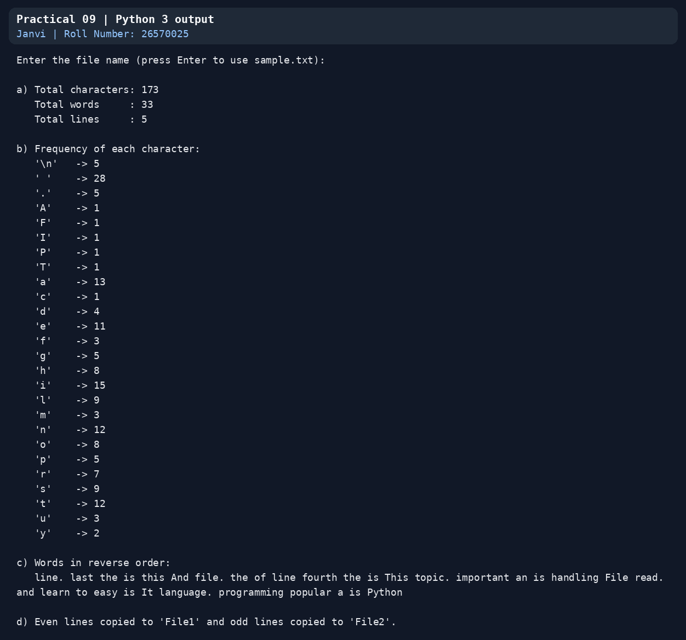


---

# Practical 10: Dictionary of Cubes

**Question:** Write a function that prints a dictionary where the keys are numbers between 1 and 5 and the values are cubes of the keys.

**Concepts used:** functions, dictionaries, `range()`

**Program** (`practical_10_dictionary_cubes.py`)

```python
# Name: Janvi
# Roll Number: 26570025

# Practical 10: Write a function that prints a dictionary where the keys are numbers
# between 1 and 5 and the values are cubes of the keys.


def print_cubes_dict():
    cubes = {}
    for n in range(1, 6):
        cubes[n] = n ** 3
    print(cubes)
    return cubes


print_cubes_dict()
```

**Sample input to try:** no input

**Output**

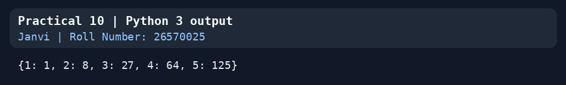


---

# Practical 11: Tuple Operations

**Question:** Consider a tuple t1=(1, 2, 5, 7, 9, 2, 4, 6, 8, 10). Write a program to perform following operations:

- a. Print half the values of the tuple in one line and the other half in the next line.
- b. Print another tuple whose values are even numbers in the given tuple.
- c. Concatenate a tuple t2=(11,13,15) with t1.
- d. Return maximum and minimum value from this tuple

**Concepts used:** tuple slicing, `tuple()` with a generator, concatenation (`+`), `max()` / `min()`

**Program** (`practical_11_tuples.py`)

```python
# Name: Janvi
# Roll Number: 26570025

# Practical 11: Consider a tuple t1 = (1, 2, 5, 7, 9, 2, 4, 6, 8, 10).
# WAP to perform following operations:
#   a) Print half the values of the tuple in one line and the other half in the next line
#   b) Print another tuple whose values are even numbers in the given tuple
#   c) Concatenate a tuple t2 = (11, 13, 15) with t1
#   d) Return maximum and minimum value from this tuple

t1 = (1, 2, 5, 7, 9, 2, 4, 6, 8, 10)
print("t1 =", t1)

# a) first half on one line, second half on the next
mid = len(t1) // 2
print("\na) First half :", *t1[:mid])
print("   Second half:", *t1[mid:])

# b) tuple of even numbers
evens = tuple(x for x in t1 if x % 2 == 0)
print("\nb) Even numbers tuple:", evens)

# c) concatenation with t2
t2 = (11, 13, 15)
t3 = t2 + t1
print("\nc) t2 + t1 =", t3)


# d) maximum and minimum
def max_min(t):
    return max(t), min(t)


maximum, minimum = max_min(t1)
print("\nd) Maximum value:", maximum)
print("   Minimum value:", minimum)
```

**Sample input to try:** no input

**Output**

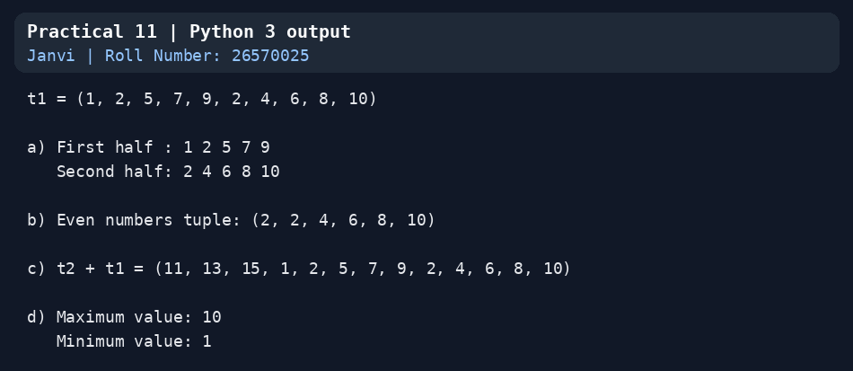


---

# Practical 12: Employee Class

**Question:** Define a class Employee that stores information about employees in the company. The class should contain the following:

- (i) data members: count (to keep a record of all the objects being created for this class) and for every employee: an employee number, Name, Dept, Basic, DA and HRA.
- (ii) function members:
  - a. `__init__` method to initialize and/or update the members. Add statements to ensure that the program is terminated if any of Basic, DA and HRA is set to a negative value.
  - b. function salary, that returns salary as the sum of Basic, DA and HRA.
  - c. `__del__` function to decrease the number of objects created for the class.
  - d. `__str__` function to display the details of an employee along with the salary of an employee in a proper format.

**Concepts used:** class attribute (`count`), `__init__`, `__del__`, `__str__`, `sys.exit()`

**Program** (`practical_12_employee_class.py`)

```python
# Name: Janvi
# Roll Number: 26570025

# Practical 12: Define a class Employee that stores information about employees in the company.
# Data members : count (number of objects created) and, for every employee, an employee number,
#                Name, Dept, Basic, DA and HRA.
# Function members:
#   a. __init__ to initialize and/or update the members; the program is terminated if any of
#      Basic, DA and HRA is set to a negative value
#   b. salary, which returns Basic + DA + HRA
#   c. __del__ to decrease the number of objects created for the class
#   d. __str__ to display the details of an employee along with the salary in a proper format
import sys


class Employee:
    count = 0                                   # class attribute: number of live Employee objects

    def __init__(self, emp_no, name, dept, basic, da, hra):
        self._counted = False
        self.emp_no = emp_no
        self.name = name
        self.dept = dept
        self.update(basic, da, hra)             # validates Basic, DA and HRA
        Employee.count += 1                     # reached only if the values were valid
        self._counted = True

    def update(self, basic, da, hra):
        """Set (or change) Basic, DA and HRA. A negative value terminates the program."""
        if basic < 0 or da < 0 or hra < 0:
            print("Error: Basic, DA and HRA cannot be negative. Terminating the program.")
            sys.exit(1)
        self.basic = basic
        self.da = da
        self.hra = hra

    def salary(self):
        return self.basic + self.da + self.hra

    def __del__(self):
        if getattr(self, "_counted", False):    # an object that failed validation was never counted
            Employee.count -= 1

    def __str__(self):
        return (f"Employee No : {self.emp_no}\n"
                f"Name        : {self.name}\n"
                f"Department  : {self.dept}\n"
                f"Basic       : Rs. {self.basic:,.2f}\n"
                f"DA          : Rs. {self.da:,.2f}\n"
                f"HRA         : Rs. {self.hra:,.2f}\n"
                f"Salary      : Rs. {self.salary():,.2f}")


e1 = Employee(101, "Janvi", "Computer Science", 30000, 12000, 8000)
e2 = Employee(102, "Aman Verma", "Mathematics", 28000, 11000, 7500)
e3 = Employee(103, "Neha Singh", "Physics", 32000, 12500, 8500)

print(e1)
print("-" * 40)
print(e2)
print("-" * 40)
print(e3)
print("-" * 40)
print("Employees created:", Employee.count)

del e3                                          # object destroyed -> __del__ runs
print("After deleting one employee:", Employee.count)

e1.update(35000, 14000, 9000)                   # update the pay components of e1
print("\nAfter updating e1:")
print(e1)

print("\nTrying to create an employee with a negative DA ...")
e4 = Employee(104, "Test User", "Chemistry", 25000, -500, 7000)
print("This line is never reached.")
```

**Sample input to try:** no input. The last lines create an employee with a negative DA, so the program **ends on purpose** with an error message

**Output**

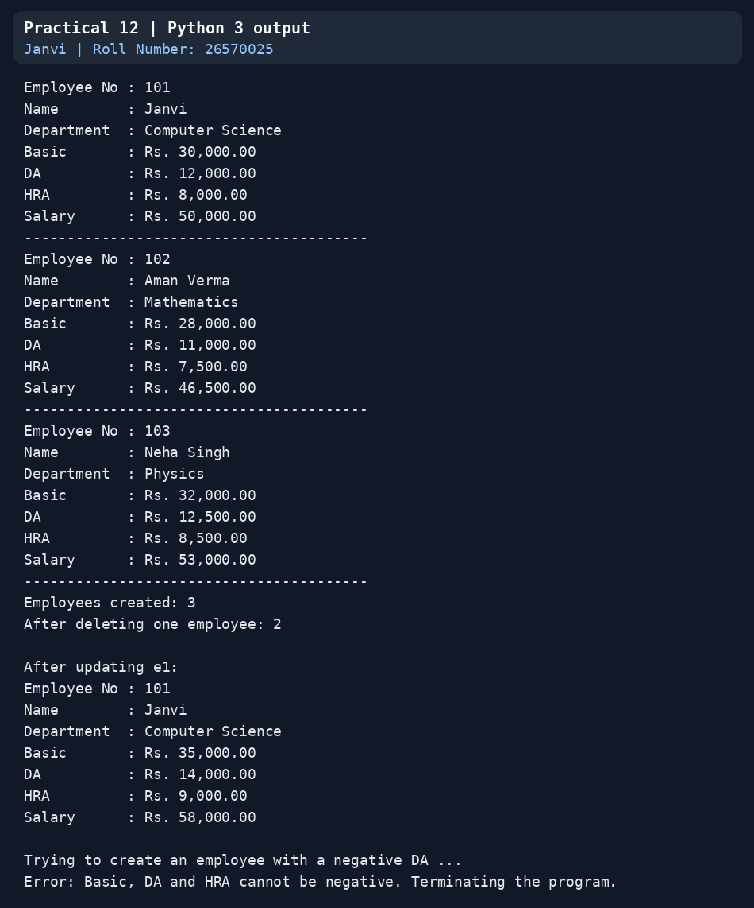


---

# Practical 13: Class 2DPoint

**Question:** Write a program to define a class "2DPoint" with coordinates x and y as attributes. Create relevant methods and print the objects. Also define a method distance to calculate the distance between any two point objects.

> A Python class name cannot begin with a digit, so the class is named `Point2D`.

**Concepts used:** classes, objects, `__str__`, `math.sqrt()`

**Program** (`practical_13_point2d.py`)

```python
# Name: Janvi
# Roll Number: 26570025

# Practical 13: Define a class "2DPoint" with coordinates x and y as attributes. Create relevant
# methods and print the objects. Also define a method distance to calculate the distance between
# any two point objects.
# Note: a Python class name cannot start with a digit, so the class is called Point2D.
import math


class Point2D:
    def __init__(self, x=0, y=0):
        self.x = x
        self.y = y

    def __str__(self):
        return f"Point2D({self.x}, {self.y})"

    def distance(self, other):
        """Distance between this point and another point."""
        return math.sqrt((self.x - other.x) ** 2 + (self.y - other.y) ** 2)

    def move(self, dx, dy):
        """Shift the point by (dx, dy)."""
        self.x += dx
        self.y += dy

    def midpoint(self, other):
        return Point2D((self.x + other.x) / 2, (self.y + other.y) / 2)


if __name__ == "__main__":
    p1 = Point2D(1, 2)
    p2 = Point2D(4, 6)
    print("p1 =", p1)
    print("p2 =", p2)
    print("Distance between p1 and p2 =", p1.distance(p2))
    print("Midpoint of p1 and p2 =", p1.midpoint(p2))

    p1.move(2, 3)
    print("After moving p1 by (2, 3): p1 =", p1)

    # Points entered by the user
    x1, y1 = map(float, input("\nEnter x and y of the first point: ").split())
    x2, y2 = map(float, input("Enter x and y of the second point: ").split())
    a, b = Point2D(x1, y1), Point2D(x2, y2)
    print(a, "and", b)
    print("Distance =", round(a.distance(b), 4))
```

**Sample input to try:** `0 0` and `3 4` (distance 5.0)

**Output**

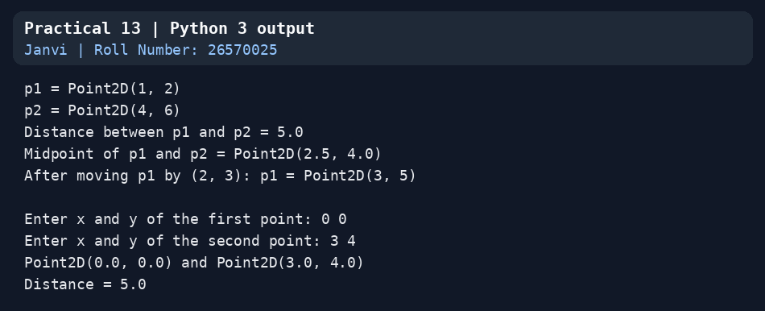


---

# Practical 14: Class 3DPoint (Inheritance)

**Question:** Inherit the above class to create a "3Dpoint" with additional attribute z. Override the method defined in "2DPoint" class, to calculate distance between two points of the "3DPoint" class.

> The class is named `Point3D`. It imports `Point2D` from `practical_13_point2d.py`, so keep both files in the same folder.

**Concepts used:** inheritance, `super()`, method overriding, `isinstance()`

**Program** (`practical_14_point3d.py`)

```python
# Name: Janvi
# Roll Number: 26570025

# Practical 14: Inherit the above class to create a "3DPoint" with an additional attribute z.
# Override the method defined in "2DPoint" to calculate the distance between two points of the
# "3DPoint" class.
# Note: class names cannot start with a digit, so the classes are Point2D and Point3D.
# Keep practical_13_point2d.py in the same folder as this file.
import math
from practical_13_point2d import Point2D


class Point3D(Point2D):
    def __init__(self, x=0, y=0, z=0):
        super().__init__(x, y)                  # x and y are set by the parent class
        self.z = z

    def __str__(self):
        return f"Point3D({self.x}, {self.y}, {self.z})"

    def distance(self, other):
        """Overridden: distance in 3-D space."""
        return math.sqrt((self.x - other.x) ** 2 +
                         (self.y - other.y) ** 2 +
                         (self.z - getattr(other, "z", 0)) ** 2)

    def move(self, dx, dy, dz):
        """Overridden: shift the point by (dx, dy, dz)."""
        super().move(dx, dy)
        self.z += dz


if __name__ == "__main__":
    p1 = Point3D(1, 2, 3)
    p2 = Point3D(4, 6, 15)
    print("p1 =", p1)
    print("p2 =", p2)
    print("Distance between p1 and p2 =", p1.distance(p2))

    p1.move(1, 1, 1)
    print("After moving p1 by (1, 1, 1): p1 =", p1)

    # The parent class is still available and unchanged
    q1, q2 = Point2D(0, 0), Point2D(3, 4)
    print("2D distance:", q1.distance(q2))
    print("Point3D is a Point2D:", isinstance(p1, Point2D))

    # Points entered by the user
    x1, y1, z1 = map(float, input("\nEnter x, y and z of the first point: ").split())
    x2, y2, z2 = map(float, input("Enter x, y and z of the second point: ").split())
    a, b = Point3D(x1, y1, z1), Point3D(x2, y2, z2)
    print(a, "and", b)
    print("Distance =", round(a.distance(b), 4))
```

**Sample input to try:** `0 0 0` and `1 2 2` (distance 3.0)

**Output**

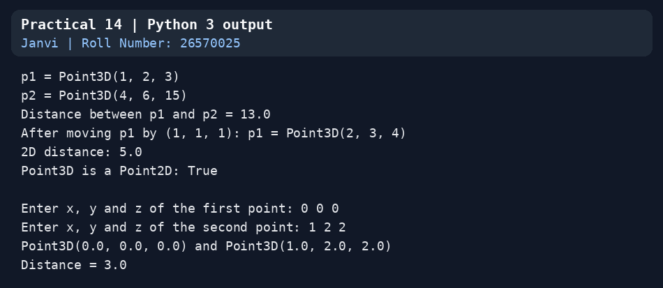


---

# Practical 15: Exception Handling

**Question:** Write a program to accept a name from a user. Raise and handle appropriate exception(s) if the text entered by the user contains digits and/or special characters.

**Concepts used:** custom exception class, `raise`, `try / except / else / finally`

**Program** (`practical_15_exception_handling.py`)

```python
# Name: Janvi
# Roll Number: 26570025

# Practical 15: WAP to accept a name from a user. Raise and handle appropriate
# exception(s) if the text entered by the user contains digits and/or special characters.


class InvalidNameError(Exception):
    """Raised when the name has digits or special characters."""
    pass


def validate_name(name):
    if name.strip() == "":
        raise ValueError("Name cannot be empty.")
    has_digit = any(ch.isdigit() for ch in name)
    has_special = any(not (ch.isalpha() or ch.isspace()) and not ch.isdigit() for ch in name)
    if has_digit and has_special:
        raise InvalidNameError("Name contains digits and special characters.")
    if has_digit:
        raise InvalidNameError("Name contains digits.")
    if has_special:
        raise InvalidNameError("Name contains special characters.")
    return name


while True:
    user_name = input("Enter your name: ")
    try:
        validate_name(user_name)
    except InvalidNameError as e:
        print("Invalid name ->", e, "Please try again.\n")
    except ValueError as e:
        print("Error ->", e, "Please try again.\n")
    else:
        print("Hello,", user_name.strip() + "! Your name is valid.")
        break
    finally:
        print("(validation finished)")
```

**Sample input to try:** `Janv1`, then `Janvi@`, then `Janvi`

**Output**

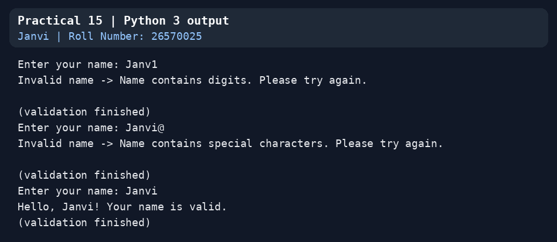


---

<p align="center"><sub>Janvi · Roll No. 26570025 · B.Sc. (Hons.) Computer Science, Semester I · Ramanujan College, University of Delhi</sub></p>


Adapted from [Python-Practical-2026](https://github.com/Shivam808119/Python-Practical-2026), with student details and output examples prepared for Janvi (26570025).
